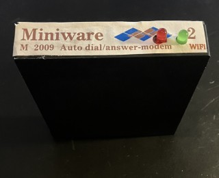
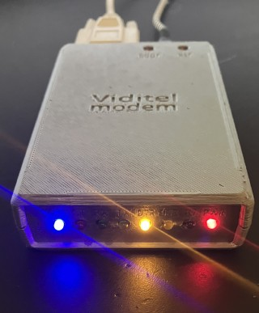
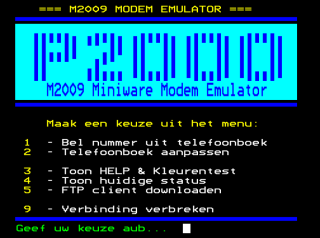
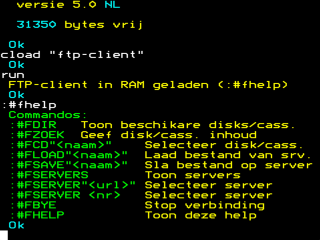

# P2000T M2009-WiFi Cartridge

Use the old M2009 Auto dial/asnwer-modem over WiFi

Wi-Fi modem hardware and firmware for the Philips P2000T home computer. This repository contains an M2009 modem cartridge emulator, a serial Viditel modem emulator, and software for connecting the P2000T to network services.

| M2009 Wi-Fi modem cartridge | Viditel modem emulator |
| --- | --- |
|  |  |
| RP2040/Pico W replacement for the Miniware M2009. | ESP32-based V.24 modem replacement. |

## Start here

- [Hardware designs](docs/hardware.md) - case files, schematic previews and sources, PCB files, and fabrication PDFs.
- [M2009 modem emulator](docs/m2009-modem-emulator.md) - setup, dialing, network services, and P2000T I/O behavior.
- [Viditel modem emulator](docs/viditel-modem-emulator.md) - serial settings, configuration, and supported services.
- [FTP client and server](docs/ftp-client-and-server.md) - using the P2000T FTP client and its server. (works only with M2009-WiFi)
- [Viewdata server](docs/viewdata-server.md) - running and connecting to a local Viewdata host.
- [Firmware build notes](src/README.md) - PlatformIO environments, build commands, and repository layout.

## Build firmware

Install PlatformIO Core, then run these commands from the repository root:

```powershell
pio run -e m2009-emulator
pio run -e viditel-modem-emulator
```

See the [firmware build notes](src/README.md) for upload instructions and details about the FTP client build.

## What does it bring you?

### Take a trip down memory lane

Open your M2009 Terminal program, dial a number, listen to the modem sounds of the 1980s, and watch your P2000T screen slowly fill with old-school graphics.



## Access the P2000T Software Preservation collection

Clone https://github.com/p2000t/software next to this repository on your PC. From the parent directory, start the [FTP server](docs/ftp-client-and-server.md), then run the FTP client on your P2000T to browse and load the preserved software as if there are on JWS-disks.

- Server command: (Winsows examample should olso work on Linux)
```console
C:\Users\<user>\Documents\GitHub>python p2000t-m2009-cartridge\src\test-server\myftpserver.py --port 8082 --file software\disks\*.dsk --file software\cassettes\

*** P2000T FTP Server ****
[START] Searching for media images in: software\disks\*.dsk
[START] Searching for media images in: software\cassettes\
Starting server with 15 'disks'
mDNS-service registreren...
[SERVER] Server running. Listening on port 8082...
```

- P2000T commands (you can download the FPT-client from the internal modem menu, option 5) 



