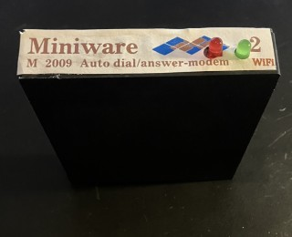
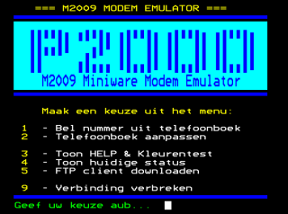
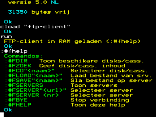

# FTP client and server

The P2000T can use the M2009 modem emulator to load and save `.cas` cassette files and files stored in JWS `.dsk` disk images. The Z80 FTP client runs on the P2000T; `myftpserver.py` provides the matching host-side server.



## FTP client

`src/ftpclient/ftp-client.asm` is assembled into `src/ftpclient/ftp-client.cas`. It starts from BASIC, relocates itself into the top of available memory, and communicates with the M2009 hardware through the Z80 SCC and line-control ports. It remains 'persistant' loaded even when onther programs are executed. 

The Basic program (ftp-client) can be downloaded via the internal menu. Use "M2009 Viewdata terminal", dial 001 to connect with the intermal menu. See option 5 to donwload. Save the client on disk or tape first. Restart the P2000T (Viewdata terminal relocates the program when downloading.)



The client supports:

- server discovery and selection;
- disk or cassette directory selection;
- directory listings;
- file loading;
- cassette-file saving;
- help and disconnect commands.
- \* can be used as wildcard (end of line only)

At the P2000T, FTP commands use BASIC command syntax such as:

```basic
:#FDIR
:#FCD"DISKNAME"
:#FZOEK
:#FLOAD"FILE.BAS"
:#FSAVE"FILE.BAS"
:#FBYE
:#FHELP
```

Server selection is handled through the modem phonebook:

```basic
:#FSERVERS
:#FSERVER <nr>
:#FSERVER"host:port"
```
examples:
```
:#fserver "viewdata-server.local:8080"
:#fcd "Spel.dsk"
:#fload "Tetris*
```


## Host server

`src/test-server/myftpserver.py` is a Python socket server for the P2000T M2009 emulator. It advertises `p2000ftp.local` with mDNS and supports JWS disk images and P2000T cassette directories.

From the repository root:

```powershell
python src/test-server/myftpserver.py -f "C:\path\to\media\*.dsk" -H 192.168.1.100 -p 21
```

Other examples:

```powershell
# Serve every .cas file in a directory tree
python src/test-server/myftpserver.py -f "C:\path\to\cassettes"

# Serve read-only media
python src/test-server/myftpserver.py -f "C:\path\to\media" --readonly

# Serve multiple locations
python src/test-server/myftpserver.py -f "C:\path\to\cassettes" -f "C:\path\to\media\*.dsk"

# Show all available options
python src/test-server/myftpserver.py --help
```

The server options include:

| Option | Purpose |
| --- | --- |
| `-f`, `--file` | Media file, wildcard, or cassette directory to serve |
| `-H`, `--host` | IP address to bind; otherwise the host address is detected |
| `-p`, `--port` | TCP port, default `21` |
| `-r`, `--readonly` | Prevent file modification |
| `-V`, `--verbose` | Enable verbose logging |
| `-D`, `--debug` | Enable detailed logging |
| `-S`, `--silent` | Suppress normal output |

Allow the selected TCP port through the Windows firewall. If mDNS does not work, use `:#FSERVER"host:port"` on the P2000T.

## Media formats

- **Disk images:** JWS-format `.dsk` files with 40 tracks, two sides, and 16 sectors per track by 256 bytes, matching the server's disk-index implementation.
- **Cassette files:** P2000T `.cas` files in preservation/tape format.
- **Cassette saving:** Supported. Saving to a disk image is not implemented.
- **Write protection:** Controlled by the host file permissions and the `--readonly` option.

## Connection protocol

A new TCP connection is used for each FTP command. Commands arrive as text followed by a carriage return. The M2009 emulator strips the `:#` prefix before forwarding the command to the server.

The server uses short response codes before text or binary data:

| Code | Meaning |
| --- | --- |
| `T` | Followed by a P2000T-formatted, nul-terminated text string |
| `S` | Client should receive a file header and begin sending cassette data |
| `U` | Existing filename found; the client asks the user to confirm overwrite |
| `R` | Server will provide a file header and binary file data |
| `A`–`Q` | Cartridge/client cassette or protocol error code |

On the P2000T, `:#FSAVE` transfers cassette data through the M2009 connection. The server parses a 2-byte little-endian file size and start address, followed by the file contents.

## Troubleshooting

- If the M2009 cartridge is not detected, verify the P2000T cartridge and I/O ports.
- If no media appears, provide at least one valid `.dsk` file or a directory containing `.cas` files.
- If saving fails, use a cassette directory and verify that write access is enabled.
- Use `-V` or `-D` to diagnose media indexing and socket commands.
