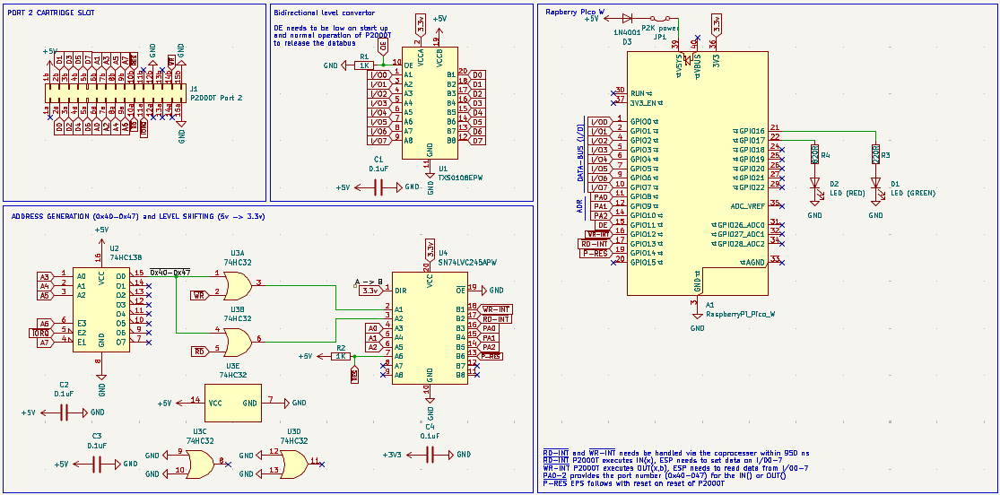
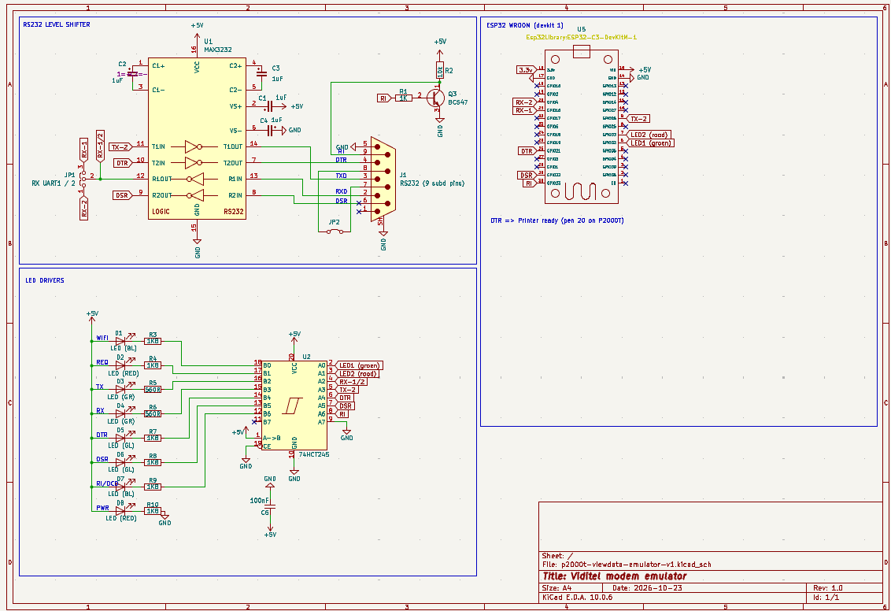
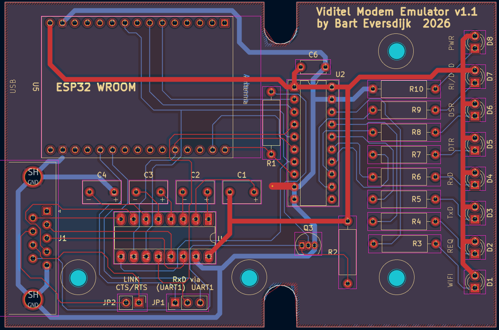

# Hardware designs

This repository includes two P2000T modem hardware designs. The images below are quick previews; the KiCad files are the editable design sources.

## M2009 Wi-Fi modem cartridge

The M2009 cartridge uses a Raspberry Pi Pico W to emulate the Miniware M2009 modem and connect the P2000T to Wi-Fi services.

- Schematic source: [KiCad schematic](../pcb/p2000t-m2009-cartridge/p2000t-m2009-cartridge.kicad_sch)
- Board source: PCB - is work in progress
- Design export: [schematic and PCB PDF](../pcb/p2000t-m2009-cartridge/p2000t-m2009-cartridge-v4.2.pdf)
- Firmware and operation: [M2009 modem emulator guide](m2009-modem-emulator.md)
 

## Viditel modem emulator

The Viditel modem emulator uses an ESP32 and provides a serial V.24 modem interface for the P2000T. The enclosure is supplied as STL files for 3D printing.

| Schematic | PCB |
| --- | --- |
|  |  |

- Schematic source: [KiCad schematic](../pcb/p2000t-viewdata-emulator/p2000t-viewdata-emulator-v1.kicad_sch)
- Board source: [KiCad PCB](../pcb/p2000t-viewdata-emulator/p2000t-viewdata-emulator-v1.kicad_pcb)
- Design export: [schematic and PCB PDF](../pcb/p2000t-viewdata-emulator/p2000t-viewdata-emulator-v1.1.pdf)
- Enclosure preview: [case render](../img/viditelmodem-case.png)
- 3D-printable parts: [front](../case/viditelmodem/Videlmodem-front.stl), [PCB support](../case/viditelmodem/Videlmodem-pcb.stl), [bottom](../case/viditelmodem/Viditelmodem-bodem.stl), [top](../case/viditelmodem/Viditelmodem-top-wh.stl)
- Firmware and operation: [Viditel modem emulator guide](viditel-modem-emulator.md)