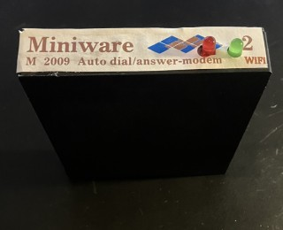
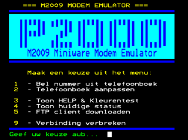
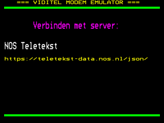

# M2009 modem emulator

The M2009 emulator is an RP2040/Pico W replacement cartridge for the P2000T. It emulates the Miniware M2009 autodial/auto-answer modem and connects Z80 SCC traffic to Wi-Fi, TCP hosts, Telnet/Viewdata services, and the FTP host/server.



## Hardware and firmware

The firmware environment is `m2009-emulator` in `platformio.ini`:

```text
Board:    Raspberry Pi Pico W (RP2040)
Platform: Arduino/Pico
Core:     earlephilhower
Monitor:  115200 baud
```

Build and upload with PlatformIO:

```powershell
platformio run --environment m2009-emulator
platformio run --target upload --environment m2009-emulator
```

## Z80 modem interface

The emulator implements the M2009 I/O ports used by the P2000T:

| Port | Function |
| --- | --- |
| `0x40` | SCC Channel A command/status |
| `0x41` | SCC Channel A data |
| `0x42` | SCC Channel B command/status |
| `0x43` | SCC Channel B data |
| `0x44`–`0x47` | Phone line control and special speed-dial commands |

The status and line-control bits provide detection, carrier, transmitter, hook, and dialing behavior expected by P2000T software. Channel B/port `0x42` is also used for M2009 detection.

## Dialing

The P2000T can dial by pulse or use the modem phonebook/speed-dial interface:

- Dial `001` to open the emulator's internal menu.
- Store or edit phonebook entries in the captive configuration portal.
- Use a numeric dialed number or a `host:port` entry for a network service.
- Incoming answer-port connections are announced as an incoming call.

The firmware maintains states for idle, line available, dialing, ringing, carrier wait, carrier detected, busy, wrong number, and no line. It switches the P2000T's SCC carrier/transmit behavior when a network connection is established.

## Direct speed dial and server communication

The M2009 emulator provides a non-standard speed-dial option for P2000T programs that do not want to use pulse dialing and carrier detection. It uses the special line-control port `0x47` (not present on the original M2009):

1. Put the modem off-hook by writing `32` (`&H20`, the phone-hook bit) to port `0x44`:

   ```basic
   OUT (&H44),32
   ```

2. Select phonebook entry *n* by writing `&H80+n` to port `0x47`:

   ```basic
   OUT (&H47),&H80+4
   ```

   Replace `4` with the required phonebook index, in the range `0`–`29`. Entry `31` (`&H9F`) is reserved for the special FTP server selection used by the FTP client.

3. Put the modem on-hook by writing `0` to port `0x44`:

   ```basic
   OUT (&H44),0
   ```

When a successful connection is established, communicate directly with the remote server through the SCC Channel A ports:

- `0x40` (`&H40`) — channel-A status/command port;
- `0x41` (`&H41`) — channel-A data port for reads and writes.

A basic P2000T BASIC polling loop can send and receive bytes as follows:

```basic
10 OUT (&H44),32
20 OUT (&H47),&H80+4
30 A=INP(&H40)
40 IF (A AND 1)<>0 THEN B=INP(&H41):PRINT ASC(B);:REM Read and print one received byte
50 IF (A AND 4)<>0 THEN OUT (&H41),C:REM Send byte C when TX is empty
60 GOTO 30
70 OUT (&H44),0
```

Useful status bits read from port `0x40` are:

| Bit | Value | Meaning |
| --- | --- | --- |
| 0 | `&H01` | A received character is available |
| 2 | `&H04` | The transmit buffer is empty |
| 3 | `&H08` | Data carrier detected / connected |

Read port `0x41` only when bit 0 of port `0x40` is set. Write port `0x41` only when bit 2 is set, so that outgoing bytes are not lost when the transmit buffer is busy.

## Captive portal for Wi-Fi and phonebook configuration

The M2009 has a shared captive portal for initial Wi-Fi setup and modem phonebook configuration.

```text
SSID: M2009-Config-Portal
Address: 192.168.4.1
```

The portal opens automatically when no valid Wi-Fi credentials are stored or when the stored network cannot be reached. It can also be opened by holding the P2000T reset line for 8–15 seconds.



On a phone or computer:

1. Connect to `M2009-Config-Portal`.
2. Open `http://192.168.4.1` or the device captive-portal/sign-in page.
3. Select the Wi-Fi network, enter its password, and optionally configure a static IP address.
4. Edit the phonebook: name, dial number, server address, and server type.
5. Save the settings and restart the emulator.

The portal supports up to 30 phonebook entries. M2009 server types include Viewdata, Teletekst, BBS, generic TCP, P2000T FTP, and the internal menu. Saved settings are retained in non-volatile memory.

Reset behavior on P2000T reset pin GP14:

| Reset duration | Action |
| --- | --- |
| 4–7 seconds | Restart the emulator |
| 8–15 seconds | Start `M2009-Config-Portal` |
| Short reset | Exit captive-portal/line on-hook |

## Network services

The firmware handles several connection types:

- **Local menu:** internal emulator commands and phonebook information;
- **Viewdata:** TCP data for a Viewdata host;
- **Teletext:** teletext-style network data;
- **FTP:** P2000T FTP protocol traffic;
- **Other:** generic TCP connections and Telnet-type services.

If `answerPort` is enabled, the emulator starts a telnet server and announces `_viewdata._tcp` and `_telnet._tcp` services through mDNS. The hostname is `m2009`/`m2009.local`.




## LEDs

The Pico W status LEDs indicate initialization and operational state:

- **Red:** Wi-Fi initialization or configuration activity, on when waiting on remote server answer.
- **Green:** Main emulator operation and Wifi-connected. (fast blink means captive portal active)


## Building and troubleshooting

- Reboot after changing Wi-Fi credentials.
- Check the Pico W serial output before debugging P2000T-side BASIC or Z80 software.
- Verify that the P2000T sees the SCC ports; the FTP client first tests whether channel A is present.
- Give Wi-Fi-connected servers a reachable LAN IP address; mDNS requires local-network support.
- Confirm that TCP ports are open in the host firewall.
- For FTP use `myftpserver.py`; for Viewdata use `myviewdataserver.py`.

## Compatible P2000T software

The emulator works with P2000T software compatible with the original M2009 modem, including:

- **M2009 Viewdata terminal**;
- **M2009 Terminal V4.8**;
- **Dagmarkt**, which can use this emulator in host/server mode.

These programs use the normal M2009 SCC ports and dialing/line-control behavior.

## Host mode and Dagmarkt

The M2009 emulator can act as a host for P2000T modem programs. Enable the answer port and start the emulator as the remote host; the P2000T running the calling program dials or connects to the host address, after which the SCC/carrier state becomes connected.

Dagmarkt can be used as a P2000T host application in this setup. The emulator is also suitable for incoming Telnet/Viewdata connections and can be discovered locally through mDNS when answer mode is enabled.


