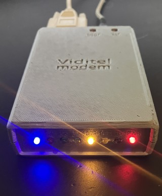
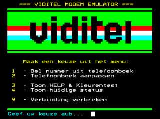
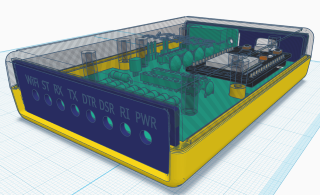
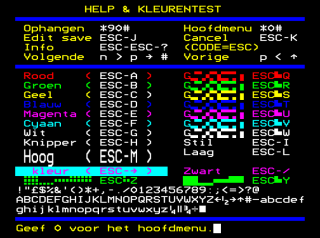

# Viditel modem emulator

The Viditel modem emulator is an ESP32-based serial V.24 modem replacement for the P2000T. It connects the P2000T's 1200/75-baud serial link to Wi-Fi and to Viewdata, Teletekst, and generic TCP services.



## Hardware and firmware

The firmware environment is `viditel-modem-emulator` in `platformio.ini`:

```text
Board:    ESP32 Dev Module
Platform: Espressif32
Framework: Arduino
Monitor:  115200 baud
```

Build and upload with PlatformIO:

```powershell
platformio run --environment viditel-modem-emulator
platformio run --target upload --environment viditel-modem-emulator
```



## Serial modem behavior

The emulator provides a V.24-style serial modem interface for the P2000T. The UART configuration is stored in flash memory and can contain separate receive/transmit baud rates, 7 or 8 data bits, and no/even/odd parity.

The firmware supports common Baud and serial settings from the captive portal, including:

- 300-baud and 1200/75-baud communication;
- 7 or 8 data bits;
- no, even, or odd parity;
- configurable incoming and outgoing answer-port behavior.

When a network connection is active, serial bytes are forwarded to the selected TCP host. The local menu and status page can be returned to with the P2000T keypad and escape/status sequences.

## Captive portal for initial Wi-Fi and phonebook setup

The Viditel emulator has a captive configuration portal named:

```text
SSID: Viditel-Config-Portal
Address: 192.168.4.1
```

The portal opens automatically on first startup, when no valid Wi-Fi credentials are stored, or when the stored network cannot be reached. It can be forced open at startup by pressing the ESP32 BOOT button (GPIO 0) just after the emulator starts.

Connect a phone or computer to `Viditel-Config-Portal`, then open the captive-portal page (`http://192.168.4.1` or the device sign-in page). The portal lets you configure:

- the Wi-Fi network name (SSID) and password;
- optional static IP address, gateway, and subnet;
- serial baud rates and data/parity settings;
- up to 30 modem phonebook entries;
- the emulator's answer-host port and status settings.



## Compatible with standard P2000T software

The Viditel modem emulator is intended for P2000T programs that use a serial V.24/Viditel modem interface. The modem is compatible with al the main Videotext applications, using a modem on the P2000T serialport, like the P2000T demo-tape application:

- **Viditel 2.2**.

Configure the emulator's baud rate, data bits, and parity to match the `Viditel 2.2` tape program (1200/75 baud, 7 bits, even parity and 1 stop bit). The programe can be used to operate the viditel emulator connecto to the local menu, Viewdata pages and phonebook/network dialing.

## Phonebook configuration

Each phonebook entry contains:

| Field | Purpose |
| --- | --- |
| Name | Display name for the destination |
| Number | Not used in Viditel moden (for M2009) |
| Server address | Host name or IP address and optional port |
| Server type | Viewdata, Teletekst, BBS, or generic TCP |

The portal page can edit all entries in one form. Save the list to flash memory with **Store list**.

At start up the user will connect to the internal menu.

A few default entries may already be configured on first use. After changing the phonebook, restart or resubmit the portal settings before dialing the updated entry.

## Network services

The firmware provides a local P2000T menu and supports:

- Viewdata/Videotex hosts;
- Teletekst/Teletext pages and HTTP proxies;
- incoming answer connections;
- mDNS services for local discovery.

It advertises the hostname `viditel.local` and Viewdata/Telnet services when an answer port is enabled.



## LEDs and diagnostics

The serial monitor speed is 115200 baud. The ESP32 reports boot, Wi-Fi, phonebook, UART, mDNS, and connection activity to the monitor.

- **Red LED:** UART/network activity or Wi-Fi initialization.
- **Green LED:** modem idle status or Wi-Fi connection state.

The exact LED behavior depends on the board's `TWOLEDS` configuration.

## Building and troubleshooting

- Hold the BOOT button during startup to force the `Viditel-Config-Portal` captive page.
- If the emulator cannot join the selected network, verify SSID/password and reset it through the portal.
- If a static IP is used, verify that gateway and subnet values match the local LAN.
- Check serial baud, word length, and parity in the portal if the P2000T display contains garbage.
- For a local Viewdata server, use `myviewdataserver.py` on port `8080` or enter its host and port in the phonebook.


