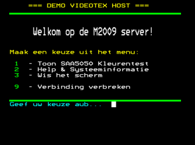
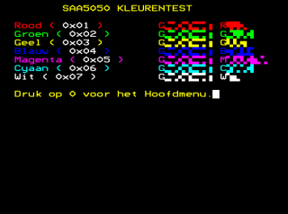

# Viewdata Demo server

`src/test-server/myviewdataserver.py` is a small Python Viewdata/Teletext host. It accepts multiple active P2000T M2009 or Viditel modem clients at the same time and sends P2000T-compatible Videotex bytes over a TCP socket.



## Requirements

The server uses Python, `zeroconf`, `msvcrt`, and the standard socket library. The `msvcrt` module is Windows-only, as is the interactive terminal-key handling in this script.

Install the discovery dependency if it is not already available:

```powershell
python -m pip install zeroconf
```

## Start the server

```powershell
python src/test-server/myviewdataserver.py
```

The default address is the computer's host IP and the default TCP port is `8080`:

```powershell
python src/test-server/myviewdataserver.py --ip 192.168.1.100 --port 8080
```

Command-line options:

| Option | Default | Purpose |
| --- | --- | --- |
| `-i`, `--ip` | Host IP | Local address on which to listen |
| `-p`, `--port` | `8080` | TCP port for modem connections |

Create an mDNS service named `viewdata-server.local` with the `_http._tcp` service type. Allow the selected TCP port through the Windows firewall.

## Built-in pages

The server sends a main menu after a client connects. Menu keys are:

| Key | Page |
| --- | --- |
| `1` | SAA5050/Videotex color test |
| `2` | Help and system information |
| `3` | Clear-screen page |
| `4` | Ping response |
| `9` | Disconnect with `NO CARRIER` |
| `0` | Return to the main menu |




## Page files

Additional binary pages can be stored in a `pages/` directory next to the server's working directory. Each file is a raw binary representation of a Videotex page:

```text
pages/100.bin
pages/100a.bin
pages/100b.bin
```

To request a page, enter `*` followed by the page number on the P2000T, for example `*100`. The server also supports:

- `#` or `_` to continue to the next lettered page;
- `*#` to continue to the next page in a sequence;
- `*00` to repeat or continue the current sequence.

The server sends data byte-by-byte with even parity and a short delay, which makes it suitable for the slower serial/modem timing of the P2000T. All outgoing pages begin with a clear-screen byte.

## Terminal control

When a client is active, the server console can forward keyboard input to the P2000T. Function and cursor keys are mapped for local control, including:

- F1: clear screen;
- Arrow keys: cursor movement or control bytes;
- Normal keys: characters plus CR/LF as needed.

Press **Ctrl+C** to stop the server and close the active connection.

## Troubleshooting

- If no connection is accepted, verify the server IP and selected port on the modem configuration page.
- If text is missing or garbled, confirm that parity and the serial/modem baud settings match the emulator/client.
- If `*100` produces no page, verify that `pages/100.bin` exists in the server working directory.
- Only one active client is maintained; a later connection replaces the active-client state.
